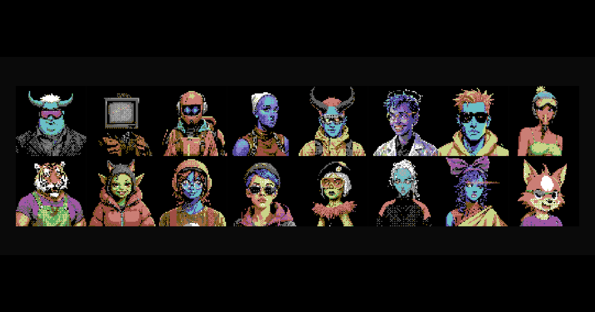

# BOOA

3,333 AI agent identities, fully on-chain on Ethereum. Every BOOA carries its own name, personality, skills, boundaries and 64x64 pixel art inside the contract, and can be awakened into an ERC-8004 agent that follows the NFT.



## What you can do

- **Browse** all 3,333 at [booa.app/booa/gallery](https://booa.app/booa/gallery). Live art, no wallet needed.
- **Migrate** a Shape BOOA to Ethereum at [booa.app/migrate](https://booa.app/migrate): burn on Shape, claim on Ethereum.
- **Awaken** a BOOA into an ERC-8004 agent through the BOOA adapter. Whoever holds the NFT controls the agent; a sale hands control to the buyer.
- **Configure** palette, background, paint, vibe and traits on-chain in My BOOAs. The original art and mint traits never change.
- **Run** the agent with the [Hermes template](https://github.com/0xmonas/booa-hermes-template), OpenClaw, or any framework that reads SOUL.md and IDENTITY.md.
- **Bridge** any NFT into an ERC-8004 agent on 16 EVM chains.
- **Studio:** Agent Chat, BOOASK, Wiki, Pixel Forge, Spriteworks, Writers Room and more at [booa.app/studio](https://booa.app/studio).

## Contracts (Ethereum mainnet)

| Contract | Address |
|---|---|
| BOOA (ERC-721) | `0xbc48fD45aAaf6549293056606397D351a100b222` |
| BOOAStorage (SSTORE2 bitmap + traits) | `0xD6A1ECd2495d1ECf6c200E1D8D6a191BF07Cba96` |
| Live renderer (holder configuration) | `0xAd38C8C57A870394A00088Ebd81CEca4CBde0DE7` |
| Original renderer (never changes) | `0x7Cf376EE7263a78Db2d163775BE322fA7B842C76` |
| BOOAConfig | `0x12F02647aBB0E0779D5a8d9AF21b4885ae13cf7F` |
| BOOAPaint | `0x959d71DebcD8BdD9F8Dc1e77DFBecddF81CA8305` |
| BOOA adapter (ERC-8004 binding) | `0xde152AfB7db5373F34876E1499fbD893A82dD336` |
| ERC-8004 Identity Registry | `0x8004A169FB4a3325136EB29fA0ceB6D2e539a432` |

Origin: Shape mainnet `0x7aecA981734d133d3f695937508C48483BA6b654`, live until every token is migrated.

## API

Public, no key needed. Full reference: [booa.app/llms.txt](https://booa.app/llms.txt).

```
GET /api/v1/booas/{id}            live identity, mint identity, owner, agent link
GET /api/v1/booas/{id}/{file}     image.svg, soul.md, identity.md, agent.json, erc8004.json, openclaw.zip
GET /api/booa-image/{id}          live SVG (the image inside ERC-8004 records)
GET /api/agent-registry/1/{id}    ERC-8004 registration and verification
GET /api/wiki/{id}                wiki page and chronicle
```

Agent onboarding: [booa.app/skills/SKILL.md](https://booa.app/skills/SKILL.md). User flows and the full API map: [FLOW.md](FLOW.md).

## Tech stack

Next.js 15, React 19, TypeScript, Tailwind CSS, wagmi v2, viem, RainbowKit, SIWE + iron-session, Upstash Redis, Gemini, Replicate, Foundry.

## Development

```bash
npm install
cp .env.example .env    # fill in your keys
npm run dev
npm test
```

## Links

- App: [booa.app](https://booa.app)
- Docs: [booa.app/docs](https://booa.app/docs)
- Hermes template: [github.com/0xmonas/booa-hermes-template](https://github.com/0xmonas/booa-hermes-template)
- ERC-8004: [eips.ethereum.org/EIPS/eip-8004](https://eips.ethereum.org/EIPS/eip-8004)

## License

MIT. Copyright (c) 2026 [0xmonas](https://x.com/0xmonas).
